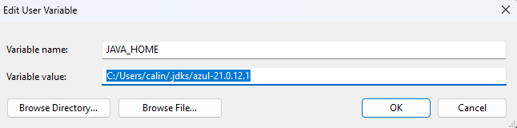

# Flight reservation system

## Table of contents:
- [Running the project](#running-the-project)
- [Endpoints](#endpoints)
- [Tradeoffs and limitations](#tradeoffs-and-limitations)
### **Running the project**
To run the project, run the

`./mvnw spring-boot:run`

command in the root directory of the project.
The service will start on port 8080.

This project uses MVNW to run, which requires a JAVA 21 JDK
You must set up the JAVA_HOME environment variable to point to your JDK installation, as seen in the picture below:

Some other useful properties that can be passed to the command (paste this if you want to customize the variables used
throughout the application):

`./mvnw spring-boot:run -Dspring-boot.run.arguments=" --<extra-argument-1>=<value-1> etc."`

Replace `<extra-argument-1>` with the name of the property you want to set, and `<value-1>` with the value you want to
set it to, and space to jump to next parameter

Examples:

| Argument                                 | Value (default) | Explanation                                                                  |
|------------------------------------------|-----------------|------------------------------------------------------------------------------|
| --booking.expiry.fixed-delay-ms          | 60000           | Time in miliseconds until booking status is revised for expiration purposes  |
| --flights.expiry.fixed-delay-ms          | 60000           | Time in miliseconds until flights status is revised for departing purposes   |                                                                             |
| --flights.booking.window.closing-minutes | 45              | Time in minutes until flight departs that bookings cannot be confirmed after |
| --spring.jpa.show-sql                    | false           | Shows spring JPA queries in console                                          |

The project also has an initial data loader that will create some flights and bookings for testing purposes. You can disable this by setting the `spring.jpa.hibernate.ddl-auto` property to `none` in the `application.properties` file or as a param
### Endpoints

| Endpoint | Route                  | Purpose                                                      | Status |
|----------|------------------------|--------------------------------------------------------------|--------|
| GET      | /flights               | List available flights, optionally filtered by date or route | Done   |
| POST     | /flights/{id}/bookings | Reserve a seat on a flight for a passenger                   | Done   |
| GET      | /flights/{id}/bookings | List bookings for flight                                     | Done   |
| POST     | /bookings/{id}/confirm | Confirm and finalise a reservation                           | Done   |
| DELETE   | /bookings/{id}         | Cancel a reservation and release the seat                    | Done   |
| POST     | /admin/flights         | Create a new flight in the system                            | Done   |
| DELETE   | /admin/flights/{id}    | Remove a flight from the system                              | Done   |

#### Postman collection

To make it easier to test the endpoints, a Postman collection is provided in the [Daon.postman_collection.json](Daon.postman_collection.json) file. 
You can import this collection into Postman and use it to send requests to the service, or use any other API testing tool of your choice.
Api-docs are also available at http://localhost:8080/swagger-ui.html

### Tradeoffs and limitations

##### Technical tradeoffs and decisions:
    
| Requirement                   | Design decision                                          | Tradeoffs                                                 | Alternative                                                                                                  |
|-------------------------------|----------------------------------------------------------|-----------------------------------------------------------|--------------------------------------------------------------------------------------------------------------|
| Flights have to take off      | Scheduler job running every minute to update status      | Useless use of resources if no flights to take off        | Webhook or cron job to run only once per flight in serverless fashion                                        |
| Held bookings must be expired | Scheduler job running every minute to update status      | Same as above                                             |                                                                                                              |
| Resiliency to double booking  | Pessimistic write lock for Flight and Booking repository | Under high traffic, concurrent books will have to wait    | Distribute the booking system using a distributed cache/message queue and abstract away the concerns of this |
| Seat availability             | Data constraints at database level                       | Hard to scale using distributed higher-layer alternatives |                                                                                                              |
|                               |                                                          |                                                           |                                                                                                              |

##### Known bugs:
    * Expiring bookings/flights are not automatically expired due to a yet to be debugged sql constraint error
    * Some funny business with initial data loader script and H2 date arithmetic
    * Some model mapper problems between entities and DTOs (easily fixable but not done due to time constraints)
    * Exception handling is a TODO, so some exceptions are not handled gracefully and will return a 500 error instead of a more appropriate error code